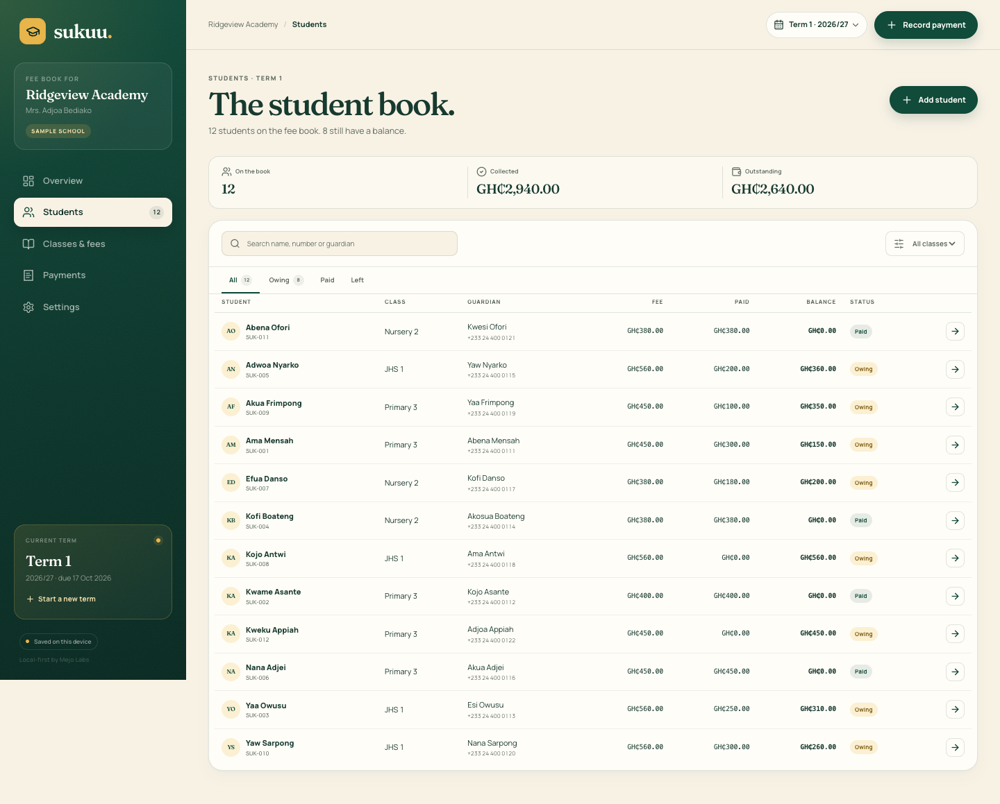
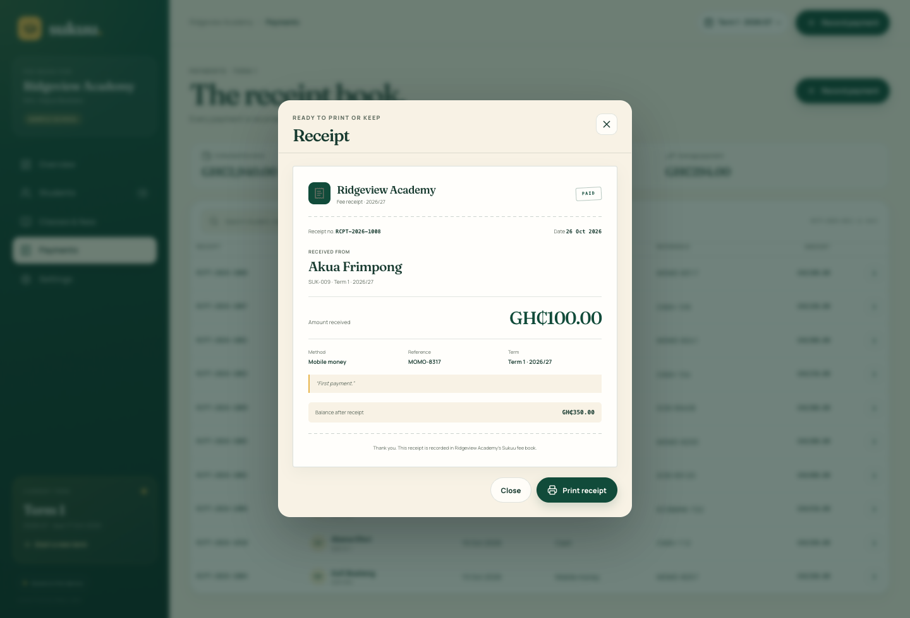
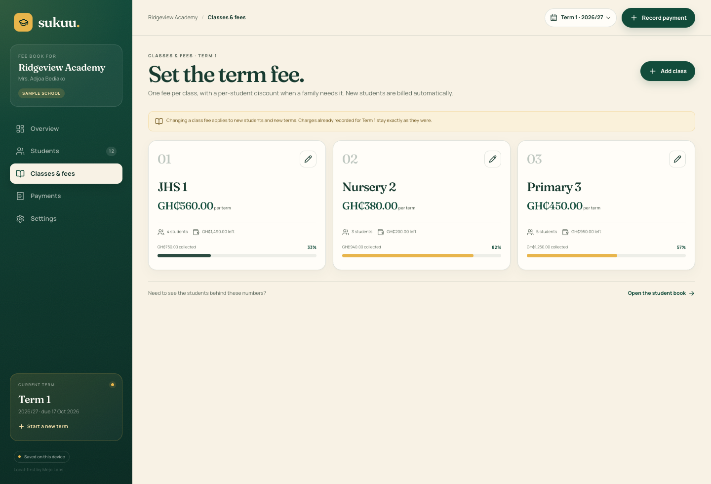
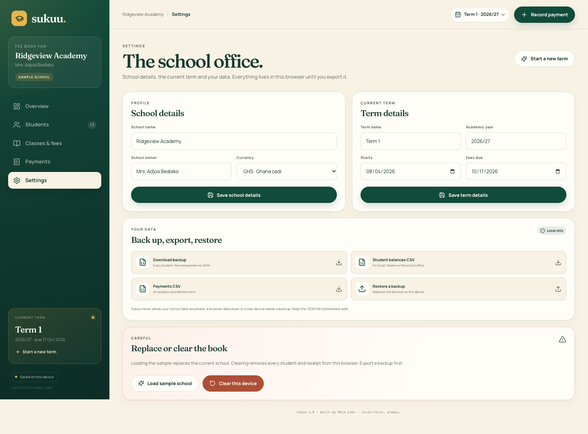
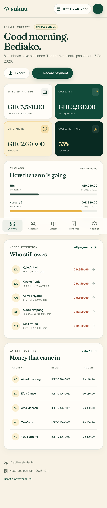

# Sukuu

**School fees, clearly.** A calm, offline-first fee ledger for small schools.

[](https://github.com/pkaycodes/sukuu/actions/workflows/ci.yml)
[](https://pkaycodes.github.io/sukuu/?demo=1)
[](LICENSE)

[](https://pkaycodes.github.io/sukuu/?demo=1)

Sukuu is a small-school finance tool for the person who keeps the fee book. It
replaces the exercise book, the spreadsheet and the “did they pay?” phone calls
with one clear record of what each child was billed, what has come in, and what
is still outstanding.

It runs entirely in the browser. There is no account, no server and no monthly
subscription. Records stay on the device and continue to work offline.

**Try the live demo:** [pkaycodes.github.io/sukuu](https://pkaycodes.github.io/sukuu/?demo=1)

The demo link opens Ridgeview Academy, a fictional school with 12 students, three
classes and 10 receipts. You can explore every feature without creating an
account. Use **Settings → Clear this device** to start your own fee book.

## What it does

### A fee book built around terms

- Set up a school and its first term in under two minutes.
- Create classes with a term fee, then bill students automatically when they join.
- Start a new term and copy active students across in one step.
- Switch between terms from the top bar. Every term keeps its own charges,
  payments and receipts.
- Historical billing is snapshotted. Changing a class fee today never rewrites
  last term's books.

### Students and guardians

- Student numbers, class, guardian name, guardian phone and office notes.
- Per-student discounts and scholarships, shown separately from the class fee.
- Search by name, student number or guardian, then filter by owing, paid or left.
- Mark a student as left without deleting their balances or payment history.

### Payments and receipts

- Record cash, Mobile Money, bank transfer or cheque payments.
- Part payments, overpayment protection and automatic balance calculations.
- Every payment gets a sequential receipt number and a clean printable receipt.
- Receipt history is searchable by student, receipt number or reference.
- Balances are shown in the school's chosen currency, stored as integer minor
  units so the arithmetic never drifts.

### Reminders and the office view

- Dashboard with expected, collected and outstanding totals, collection rate,
  class-by-class progress and the students who still owe.
- A one-click WhatsApp click-to-chat reminder, prefilled with the student, term
  and balance. Sukuu does not send messages automatically.
- Student account view with fee breakdown, guardian contact and full receipt
  history.

### Data you control

- Local-first storage. There is no Sukuu server.
- Printable receipts and CSV exports for student balances and payments.
- Complete JSON backup and restore.
- Installable PWA with offline support.
- Demo data is clearly labelled and can be replaced or cleared at any time.

## Screens

| The student book | A printable receipt |
| --- | --- |
|  |  |

| Classes and fees | The school office |
| --- | --- |
|  |  |

<table>
  <tr>
    <td width="50%"></td>
    <td width="50%"></td>
  </tr>
</table>

## Design decisions

**Terms are the unit of truth.** A billing record is never just “this student
owes the current class fee.” It is a snapshot of the class, fee and discount for
one term. That makes switching terms safe and keeps historical receipts and
balances honest.

**Money is never a float.** Amounts are stored as integer minor units (for
example, `GH₵450.00` is `45000`) and formatted only at the edge. Input accepts
human-friendly values such as `1,250.50` and rejects ambiguous decimal input.

**Local-first by default.** A school office may have patchy internet, a shared
computer and no IT department. Sukuu works from `localStorage`, precaches the app
for offline use and makes backup/restore a first-class action. There is no
silent sync or account layer.

**One job per screen.** The dashboard answers “how is the term going?”. The
student book answers “who needs attention?”. The receipt book answers “what came
in?”. The navigation does not pretend this is an enterprise ERP.

## Tech stack

- React 19 + TypeScript
- Vite 8
- `vite-plugin-pwa` for the installable offline app
- Fraunces + Manrope via Fontsource
- Vitest + Testing Library
- No component library, no backend, no analytics

## Run it locally

Requires Node.js 22 or newer.

```bash
npm install
npm run dev
```

Open the URL printed by Vite. To load the sample school directly:

```text
http://localhost:5173/?demo=1
```

### Quality checks

```bash
npm run lint
npm run typecheck
npm test
npm run build
```

The test suite covers money parsing, term summaries and balances, database
validation and backup restore, plus full user journeys: setting up a school,
adding a class, adding a student, recording a payment, issuing a receipt,
filtering the student book and rejecting an overpayment.

### Production build

```bash
npm run build
npm run preview
```

The PWA build is configured for GitHub Pages under `/sukuu/` when running in
GitHub Actions. The local build uses `/`.

## Project structure

```text
src/
  components/    Overview, students, classes, payments, settings and dialogs
  hooks/         Local-first state and all mutations
  lib/           Money, dates, fee calculations, storage, CSV and sample data
  test/          Vitest setup
  App.tsx        App shell, routing and dialog orchestration
public/          PWA icons and social image
docs/            Product screenshots used in this README
```

The domain layer is deliberately framework-free. `lib/calc.ts` contains account
balances, term summaries and receipt numbering; `lib/storage.ts` validates every
record on import so a malformed backup cannot corrupt the fee book.

## Privacy

Sukuu collects nothing. There are no cookies, trackers or remote requests after
the app has loaded. The demo school is generated locally. Student names, phone
numbers and payment records remain in the browser unless you export them.

Because data is local, clearing browser storage will remove the fee book. Export
a JSON backup before clearing the device or moving to another computer.

## Status and next steps

Sukuu is a complete, tested first release. Sensible next steps would be:

- Optional encrypted multi-device sync for schools with more than one office
  computer.
- SMS/WhatsApp reminder delivery through an opt-in provider, with delivery logs.
- A PDF receipt pack for a whole term.
- Bulk student import from a spreadsheet.

These are deliberately not faked in the demo. The current reminder action opens
WhatsApp with a prefilled message; it does not claim to send anything by itself.

## License

MIT © 2026 Papakwame Afrifa Mensa. See [LICENSE](LICENSE).
